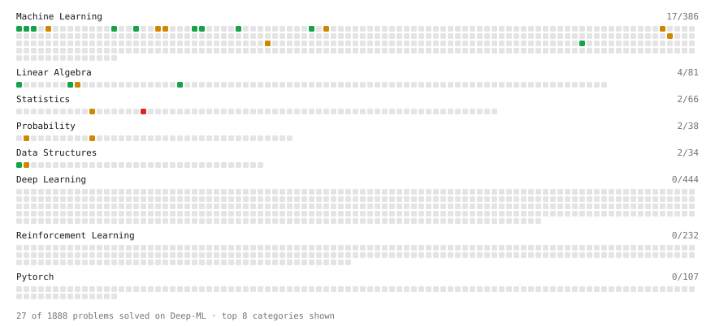

# Deep-ML

My machine learning practice from [Deep-ML](https://www.deep-ml.com). Every solution here was written by hand.

**48** solved · 35 problems · 0 labs · 13 math

[**Browse the interactive portfolio**](https://letqo.github.io/deep-ml/) to replay this filling in over time.

## Problems

| | Difficulty | Solved | |
| --- | --- | --- | --- |
| [Binary Classification with Logistic Regression](https://www.deep-ml.com/problems/104) | easy | 2026-11-05 | [solution](problems/0104-binary-classification-with-logistic-regression) |
| [Calculate 2x2 Matrix Inverse](https://www.deep-ml.com/problems/8) | easy | 2026-10-28 | [solution](problems/0008-calculate-2x2-matrix-inverse) |
| [Calculate R-squared for Regression Analysis](https://www.deep-ml.com/problems/69) | easy | 2026-10-30 | [solution](problems/0069-calculate-r-squared-for-regression-analysis) |
| [Calculate Root Mean Square Error (RMSE)](https://www.deep-ml.com/problems/71) | easy | 2026-10-30 | [solution](problems/0071-calculate-root-mean-square-error-rmse) |
| [Detect Overfitting or Underfitting](https://www.deep-ml.com/problems/86) | easy | 2026-10-30 | [solution](problems/0086-detect-overfitting-or-underfitting) |
| [Feature Scaling Implementation](https://www.deep-ml.com/problems/16) | easy | 2026-10-01 | [solution](problems/0016-feature-scaling-implementation) |
| [Implement Early Stopping Based on Validation Loss](https://www.deep-ml.com/problems/135) | easy | 2026-11-03 | [solution](problems/0135-implement-early-stopping-based-on-validation-loss) |
| [Implement Orthogonal Projection of a Vector onto a Line](https://www.deep-ml.com/problems/66) | easy | 2026-10-28 | [solution](problems/0066-implement-orthogonal-projection-of-a-vector-onto-a-line) |
| [Implement Ridge Regression Loss Function](https://www.deep-ml.com/problems/43) | easy | 2026-11-02 | [solution](problems/0043-implement-ridge-regression-loss-function) |
| [Linear Regression Using Gradient Descent](https://www.deep-ml.com/problems/15) | easy | 2026-10-28 | [solution](problems/0015-linear-regression-using-gradient-descent) |
| [Linear Regression Using Normal Equation](https://www.deep-ml.com/problems/14) | easy | 2026-10-28 | [solution](problems/0014-linear-regression-using-normal-equation) |
| [Matrix-Vector Dot Product](https://www.deep-ml.com/problems/1) | easy | 2026-10-28 | [solution](problems/0001-matrix-vector-dot-product) |
| [Min-Max Scaling of Feature Values](https://www.deep-ml.com/problems/112) | easy | 2026-10-01 | [solution](problems/0112-min-max-scaling-of-feature-values) |
| [One-Hot Encoding of Nominal Values](https://www.deep-ml.com/problems/34) | easy | 2026-10-01 | [solution](problems/0034-one-hot-encoding-of-nominal-values) |
| [Random Train/Validation/Test Split with Shuffling](https://www.deep-ml.com/problems/1058) | easy | 2026-10-01 | [solution](problems/1058-random-train-validation-test-split-with-shuffling) |
| [Sigmoid Activation Function Understanding](https://www.deep-ml.com/problems/22) | easy | 2026-11-05 | [solution](problems/0022-sigmoid-activation-function-understanding) |
| [Softmax Activation Function Implementation ](https://www.deep-ml.com/problems/23) | easy | 2026-11-05 | [solution](problems/0023-softmax-activation-function-implementation) |
| [Bias-Variance Decomposition from Bootstrap](https://www.deep-ml.com/problems/804) | medium | 2026-11-03 | [solution](problems/0804-bias-variance-decomposition-from-bootstrap) |
| [Central Limit Theorem Simulation](https://www.deep-ml.com/problems/182) | medium | 2026-11-03 | [solution](problems/0182-central-limit-theorem-simulation) |
| [Derivative of Cross-Entropy Loss w.r.t. Logits](https://www.deep-ml.com/problems/220) | medium | 2026-11-05 | [solution](problems/0220-derivative-of-cross-entropy-loss-w-r-t-logits) |
| [Derivative of Softmax](https://www.deep-ml.com/problems/219) | medium | 2026-11-05 | [solution](problems/0219-derivative-of-softmax) |
| [Elastic Net Regression via Gradient Descent](https://www.deep-ml.com/problems/139) | medium | 2026-11-03 | [solution](problems/0139-elastic-net-regression-via-gradient-descent) |
| [Handle Missing Data with Imputation](https://www.deep-ml.com/problems/354) | medium | 2026-10-29 | [solution](problems/0354-handle-missing-data-with-imputation) |
| [Implement Gradient Descent Variants with MSE Loss](https://www.deep-ml.com/problems/47) | medium | 2026-10-28 | [solution](problems/0047-implement-gradient-descent-variants-with-mse-loss) |
| [Implement K-Fold Cross-Validation](https://www.deep-ml.com/problems/18) | medium | 2026-11-03 | [solution](problems/0018-implement-k-fold-cross-validation) |
| [Implement Lasso Regression using ISTA](https://www.deep-ml.com/problems/50) | medium | 2026-11-02 | [solution](problems/0050-implement-lasso-regression-using-ista) |
| [Matrix times Matrix ](https://www.deep-ml.com/problems/9) | medium | 2026-10-28 | [solution](problems/0009-matrix-times-matrix) |
| [Maximum Likelihood Estimation for Gaussian Distribution](https://www.deep-ml.com/problems/337) | medium | 2026-11-03 | [solution](problems/0337-maximum-likelihood-estimation-for-gaussian-distribution) |
| [Normal Distribution PDF Calculator](https://www.deep-ml.com/problems/80) | medium | 2026-11-03 | [solution](problems/0080-normal-distribution-pdf-calculator) |
| [Numerical Gradient Checking](https://www.deep-ml.com/problems/313) | medium | 2026-10-29 | [solution](problems/0313-numerical-gradient-checking) |
| [RSE, R-Squared and the F-Statistic](https://www.deep-ml.com/problems/1361) | medium | 2026-11-05 | [solution](problems/1361-rse-r-squared-and-the-f-statistic) |
| [StandardScaler Fit and Transform](https://www.deep-ml.com/problems/842) | medium | 2026-10-01 | [solution](problems/0842-standardscaler-fit-and-transform) |
| [Coefficient Standard Errors, t-Statistics and p-Values](https://www.deep-ml.com/problems/1360) | hard | 2026-11-03 | [solution](problems/1360-coefficient-standard-errors-t-statistics-and-p-values) |
| [Train Logistic Regression with Gradient Descent](https://www.deep-ml.com/problems/106) | hard | 2026-11-05 | [solution](problems/0106-train-logistic-regression-with-gradient-descent) |
| [Train Softmax Regression with Gradient Descent](https://www.deep-ml.com/problems/105) | hard | 2026-11-05 | [solution](problems/0105-train-softmax-regression-with-gradient-descent) |

## Math

| | Difficulty | Solved | |
| --- | --- | --- | --- |
| [Model Selection: CV, AIC, and BIC](https://www.deep-ml.com/math-problems/43) | easy | 2026-11-02 | [solution](math/0043-model-selection-cv-aic-and-bic) |
| [Probability Fundamentals](https://www.deep-ml.com/math-problems/19) | easy | 2026-11-03 | [solution](math/0019-probability-fundamentals) |
| [Bias–Variance Decomposition](https://www.deep-ml.com/math-problems/39) | medium | 2026-10-30 | [solution](math/0039-bias-variance-decomposition) |
| [Common Distributions II: Normal, Poisson, Exponential](https://www.deep-ml.com/math-problems/22) | medium | 2026-11-03 | [solution](math/0022-common-distributions-ii-normal-poisson-exponential) |
| [Inverse and Rank](https://www.deep-ml.com/math-problems/12) | medium | 2026-10-28 | [solution](math/0012-inverse-and-rank) |
| [Law of Large Numbers and Central Limit Theorem](https://www.deep-ml.com/math-problems/23) | medium | 2026-11-03 | [solution](math/0023-law-of-large-numbers-and-central-limit-theorem) |
| [Least Squares as Maximum Likelihood under Gaussian Noise](https://www.deep-ml.com/math-problems/156) | medium | 2026-11-03 | [solution](math/0156-least-squares-as-maximum-likelihood-under-gaussian-noise) |
| [Matrix Multiplication](https://www.deep-ml.com/math-problems/10) | medium | 2026-10-28 | [solution](math/0010-matrix-multiplication) |
| [Orthogonality and Projections](https://www.deep-ml.com/math-problems/14) | medium | 2026-10-28 | [solution](math/0014-orthogonality-and-projections) |
| [Regularization and Generalization](https://www.deep-ml.com/math-problems/31) | medium | 2026-10-30 | [solution](math/0031-regularization-and-generalization) |
| [Statistical Inference](https://www.deep-ml.com/math-problems/27) | medium | 2026-11-03 | [solution](math/0027-statistical-inference) |
| [Training Error, Test Error and the Bayes Rate](https://www.deep-ml.com/math-problems/104) | medium | 2026-10-30 | [solution](math/0104-training-error-test-error-and-the-bayes-rate) |
| [Ridge vs Lasso: Constraint Geometry and Soft-Thresholding](https://www.deep-ml.com/math-problems/94) | hard | 2026-11-02 | [solution](math/0094-ridge-vs-lasso-constraint-geometry-and-soft-thresholding) |

---

_This file is regenerated by Deep-ML on every push._
